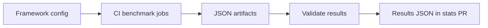
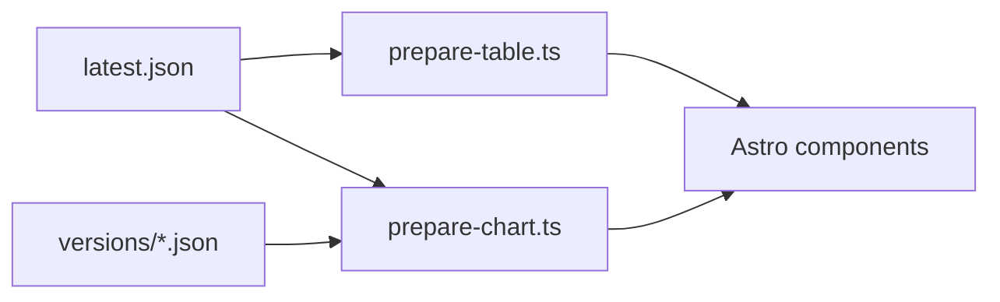

# Contributing to the Framework Performance Project

The Framework Performance project is part of the e18e.dev community. Want to get involved? Head to our Discord at https://chat.e18e.dev. If you're keen to contribute to the project and get stuck straight into code, we have an open list of good first issues in our GitHub repo: [Good First Issues](https://github.com/e18e/framework-performance/issues?q=is%3Aissue%20state%3Aopen%20label%3A%22good%20first%20issue%22). We keep this list updated and add new issues every week. It's one of the easiest ways to get involved and help push the project forward.

## Where to Start

The Framework Performance project has a few different areas which you can contribute to:

- **Improving Metrics**: Suggest new metrics or improve the way we collect and display existing ones.

- **Documentation**: Enhance our documentation site by fixing typos, improving explanations, or adding new sections.

- **UI/UX Improvements**: Help us improve the documentation site by suggesting design improvements, fixing bugs, or adding new features.

- **Adding New Frameworks**: Help us expand our list of tracked frameworks by adding new ones. See the [Adding a New Framework](./CONTRIBUTING.md#adding-a-new-framework) section below for details, as each new framework adds significant maintenance burden. PRs that add a new meta-framework without following the linked instructions will be rejected, as it takes a lot of time to ensure it meets the standards of our benchmarking suite.

### Project Structure

This is a monorepo managed with pnpm workspaces hosting multiple packages. However, some of the packages are not part of the workspace.

The workspace includes the Astro documentation site, the stats generator, the results package, and the Core Web Vitals collector.

```
framework-performance/
└── packages/
    ├── docs/            # Astro-based documentation site
    ├── stats-generator/ # Tool for collecting framework metrics
    ├── results/         # Framework config, schemas, and benchmark results
    └── cwv-stats/       # Core Web Vitals data collection
```

Outside of the workspace, we have individual packages for each framework's starter project and app project. These are used to run the actual measurements for each framework.

```
framework-performance/
└── packages/
    ├── starter-*/    # Metaframeworks configured using default set up
    └── app-*/        # Metaframeworks configured for run time tests
```

Any project marked with `starter` in the name should be a direct setup of the meta-framework's recommended default configuration. For most of these, we have followed the official getting started guide and used the CLI to set up the project with the recommended path. We often use these to measure dev time performance metrics like build times, dependency counts, and CI performance. It's hard to compare meta-frameworks, so sometimes it's easier to compare the default setup of each framework, as this is what most users will start with and gives a good baseline for comparison. Full details on each `starter` set up can be found in our docs site [methodologies page](https://frameworks.e18e.dev/methodology/#project-setups).

Any project marked with `app` in the name is a more complex setup on which we often run runtime performance tests. These are often more customized and have more features added on top of the default starter set up. This is because we want to test the performance of each framework under more real world conditions and with more complex features implemented. For example, we might add a blog page with dynamic routing, or a dashboard page with client side interactivity. This allows us to test the performance of each framework under more realistic conditions and see how they perform as the complexity of the app increases.

Having both a `starter` and `app` project for each framework allows us to get a more comprehensive view of the performance of each framework across different use cases and levels of complexity and create more fair comparisons.

### How Metrics Work

GitHub Actions runs the benchmark scripts from `packages/stats-generator` on Depot runners.

#### CI Metrics Collection

The current flow for collecting metrics is as follows:

1. The [Benchmarks workflow](./.github/workflows/generate-stats.yml) runs on PRs to `main` and pushes to `main` that match its path filters. It also supports manual runs.
2. It validates first-party dependency manifests and reads the framework config to select measurements for each `app` and `starter`.
3. Repository benchmarks run on Depot; see [Default Benchmark Setup](./packages/docs/src/content/docs/methodology.md#default-benchmark-setup) for the shared environment and test-specific exceptions.
4. The measurement jobs upload JSON artifacts. **Validate results** checks those artifacts and the assembled results.
5. After validation on `main`, the workflow opens or updates a PR if results changed. The docs site reads the combined data from `packages/results/data/<framework>/latest.json` and `versions/<version>.json`.



### Framework Configuration

- [`frameworks.ts`](./packages/results/src/frameworks.ts) selects which measurements run for each starter and app.
- Put benchmark settings in [`measurements.ts`](./packages/results/src/measurements.ts). For example, `install: { runs: 5 }` runs five install measurements per job for each enabled starter. Entries like `dependencies: {}` have no configurable repeat count here.

Edit the TypeScript config. [`print-frameworks.ts`](./packages/stats-generator/src/print-frameworks.ts)
prints it as JSON so CI can build its benchmark matrices. Astro imports the same
registry for framework names and ordering, and for validating Code Comparison slugs.

```ts
{
  name: 'astro',
  displayName: 'Astro',
  frameworkPackage: 'astro',
  starter: {
    package: 'starter-astro',
    buildScript: 'build',
    buildOutputDir: 'dist',
    measurements: ['install', 'build', 'dependencies'],
  },
  app: {
    package: 'app-astro',
    buildScript: 'build',
    buildOutputDir: 'dist',
    measurements: ['ssrRequestThroughput'],
  },
},
```

#### Container Metrics Collection

The SSR Load and SSR Router Link Load benchmarks run in Docker on Depot. The
commands for reproducing each job are in [Measure Framework](./.github/workflows/measure-framework.yml).

### Result Schemas

[`schemas.ts`](./packages/results/src/schemas.ts) defines the Zod schemas used
to validate benchmark output and derive TypeScript types. Record what actually
ran, the samples, and the summaries in the benchmark result using the fields
defined by its schema. Update `FrameworkSchema` and `PackagePathSchema` when
adding a framework.
[`storage.ts`](./packages/results/src/storage.ts) uses those schemas to validate
the combined JSON and associate each measurement with its starter or app.

### How the Docs Use Results

Astro imports benchmark JSON from `packages/results/data/` at build time.

- [`prepare-table.ts`](./packages/docs/src/lib/prepare-table.ts) reads `latest.json` and formats table data.
- [`prepare-chart.ts`](./packages/docs/src/lib/prepare-chart.ts) reads `latest.json` and `versions/*.json` to prepare current and historical chart data.



### Versioning

We track one release per major or minor version of each meta-framework. Use the
latest available patch release for that major or minor version. When updating
the framework version, also update the other direct packages in its starter and
app projects to the latest compatible versions available on the framework
release date.

For a newer patch within a major or minor version already tracked (for example,
SolidStart `2.0.0` to `2.0.5`), update the exact framework version in both the
starter and app `package.json` files, regenerate both lockfiles, and update the
starter's `first-party-dependencies.json`. Under `packages/results/data/<framework>/`,
update `frameworkVersion` and the framework dependency version for each affected
project in `latest.json` and `versions/<old-version>.json`. Rename the versioned
file to the new patch version to replace the old entry in the major or minor
history.
Leave measured values and diagnostic messages unchanged; they still reflect the
previous patch until the Benchmarks workflow reruns after the change reaches
`main` and opens a stats update PR.

Framework version bumps are currently manual. CI runs the measurements on the
PR and publishes fresh results through a stats update PR after the change
reaches `main`.

#### First-party direct dependencies

Every tracked starter includes `first-party-dependencies.json`: a small package
manifest containing the direct dependencies that belong to the framework's own
project or ecosystem. It uses the same `dependencies` and `devDependencies`
sections as the starter's `package.json`, with the same version ranges. For example:

```json
{
  "dependencies": {
    "astro": "7.1.6"
  },
  "devDependencies": {
    "@astrojs/check": "0.9.10"
  }
}
```

Include only direct package entries from the starter's `package.json`; do not
include transitive packages. The manifest separates a starter's direct framework
packages from its other direct packages. It does not classify the transitive
dependency tree.

When changing a starter's dependencies, review this file in the same PR. Add a
new first-party package, remove one no longer declared, and leave third-party
packages out. Confirm ownership from the package's source project rather than
assuming matching names or scopes are first-party.

The Benchmarks workflow checks that every entry remains in the same dependency
section with the same version as the starter's `package.json`.

When an upgrade changes the build tool, adapter, starter setup, or benchmark
behavior, update the methodology in the same PR using the checklist below.

### Keeping the Methodology Up to Date

Update [the methodology source](./packages/docs/src/content/docs/methodology.md)
in the same PR when adding a meta-framework or changing a project's setup,
benchmark behavior, or test environment. Describe what the committed
configuration actually runs, including changes introduced by version upgrades.

- **Default Benchmark Setup:** Update shared settings when Node, pnpm selection,
  runner hardware, browser configuration, or dependency installation changes.
  Put an exception that applies to only one test in that test's section.
- **Framework Build Tools and Adapters:** Add or update the framework's UI
  library, build tool, and runtime adapter/server in the table. Keep table
  entries short; use the dot points below it for presets, custom server entries,
  and differences between starter and runtime packages. Mark a missing starter
  or runtime app explicitly rather than implying it is benchmarked.
- **Dev Time → Project Setups:** Record the CLI command and selected options, or
  documented setup steps, for a new starter. Update them when the starter setup
  changes, including any changes made after generation.
- **Run Time → Framework Specific Notes:** Explain framework-wide rendering
  choices and why they are needed. Keep build tool and adapter details in the
  shared table rather than repeating them here.
- **Individual benchmark sections:** Document new or changed routes, data,
  rendering and navigation behavior, measurement tools, repetitions,
  aggregation, and environment exceptions where relevant. Explain departures
  from a framework's default behavior and how they affect the comparison.
- **Links and versions:** Keep the home, Dev Time, and Run Time pages linked to
  Default Benchmark Setup. Update affected methodology links if headings change.
  Exact dependency versions belong in project manifests and lockfiles; routine
  version updates do not need to be duplicated in the setup table.

Check the documentation against the affected project configuration, benchmark
code, and CI workflow. Run `pnpm build:docs` and check formatting for the edited
files. In the PR description, explain any change that affects comparison with
previous results.

### Adding a New Framework

Adding a new framework increases the maintenance burden, so please open an issue to discuss it and get approval before starting work. It takes a lot of time to ensure each framework is set up fairly and consistently to achieve the best outcomes for our benchmarks. We also have to ensure that any meta-framework being added meets our requirements and capabilities. For example, not being in one or two benchmarks is fine, but if the framework in question can't do half of them, it does not belong in these benchmarks. Failing to follow this process will lead to PRs being auto-rejected that add new meta-frameworks

If your issue is approved and your PR merged, you are expected to help maintain its integration after it is merged. This includes framework and dependency upgrades, fixing build or benchmark failures, being available to validate setup when new benchmarks are added and keeping its setup and methodology documentation current. Please state in your PR that you can provide this ongoing support. All accepted frameworks are tracked equally.

If approved, follow these steps:

1. **Create the starter package**: Add a new directory in `packages/` (e.g., `packages/starter-my-framework`). Set it up using the framework's official CLI or getting started guide with the recommended defaults. The starter should not be added to the pnpm workspace — it has its own independent `package.json` and lockfile. Pin the core framework dependency to an exact version (e.g., `"my-framework": "2.0.0"` not `"^2.0.0"`). Add `first-party-dependencies.json` with the starter's direct first-party packages.

2. **Create the app package** (optional): If runtime performance testing is planned, add an `app-*` package (e.g., `packages/app-my-framework`) with a more complex setup that includes features like dynamic routing or client-side interactivity. Make sure the framework dependency is pinned to the same exact version as the starter package.

3. **Add an entry to `packages/results/src/frameworks.ts`** using the same format as the framework configuration example above.

   ```ts
   {
     name: 'my-framework',
     displayName: 'My Framework',
     frameworkPackage: 'my-framework',
     starter: {
       package: 'starter-my-framework',
       buildScript: 'build',
       buildOutputDir: 'dist',
       measurements: ['install', 'build', 'dependencies'],
     },
   },
   ```

4. **Update the methodology**: Follow [Keeping the Methodology Up to Date](#keeping-the-methodology-up-to-date). Add the framework to the build tools and adapters table, document its starter setup, and explain any runtime or test-specific differences.

5. **Test locally**: Make sure the framework builds successfully by running the build script from inside the package directory.

6. CI for `sync-version` and `generate-stats` will automatically pick up the new framework from `packages/results/src/frameworks.ts`. The Benchmarks workflow runs the same measurements and validates their outputs on pull requests and on `main`; only runs on `main` save the results and create a stats update PR.

7. **Submit a PR**: Open a pull request with the new packages, configuration, and methodology updates. Once merged, the CI will automatically pick up the new framework and raise a PR with new metrics.

### Adding a Code Comparison Example

The [Code Comparison](https://frameworks.e18e.dev/code-comparison/) page is driven by markdown files in `packages/docs/src/content/code-comparison/<example>/<framework>.md`. One file per framework, named after its starter package in the framework config with the `starter-` prefix removed. Anything else under that folder fails `pnpm type-check`, including a stray file at the wrong depth or with the wrong extension. A framework with no file gets a placeholder tab, so a partial example still ships.

Each file holds optional frontmatter, optional prose, and one fenced code block per file the task needs:

````md
---
docs: https://svelte.dev/docs/kit/routing
---

```svelte title="src/routes/about/+page.svelte"
<h1>About</h1>
```
````

The rules the page depends on:

- `title=` is the path relative to the starter package root, and the block is the **complete** file at that path. A reader must be able to write every block verbatim into a fresh copy of `packages/starter-<framework>` and have the example work with no other edits and no added dependencies. Replace a file the starter already ships rather than showing a diff of it.
- Keep snippets minimal. No layouts, styling, metadata, or test ids.
- Prose is for a step the framework needs beyond adding a file. One or two sentences.
- `docs` is optional and must be a working URL to that framework's guide for the task.

Adding a new example means adding the folder plus a `##` heading and a `<CodeComparison example="..." />` line in `packages/docs/src/content/docs/code-comparison.mdx`. Nothing else changes, so examples can be contributed in parallel.

Verify a snippet before opening the PR. CI checks the Markdown during the docs build. To test the snippet itself, copy the starter to a scratch directory, run `pnpm install`, write every block into it at its `title=` path, run `pnpm dev`, and request the routes the example adds.

Run `pnpm format` too. Prettier reformats `astro`, `vue`, `ts`, and `tsx` fences to this repo's style. It leaves `svelte` fences alone, since `prettier-plugin-svelte` is not installed here, so format those by hand to match.

### Getting Started

To get the project running locally:

1. **Prerequisites**: Install [nvm](https://github.com/nvm-sh/nvm) and the pnpm version declared in the root `package.json`. Node.js is pinned to an exact version in `.nvmrc`.

2. **Clone the repo**:

   ```bash
   git clone https://github.com/e18e/framework-performance.git
   cd framework-performance
   ```

3. **Select the pinned Node.js version and install workspace dependencies**:

   ```bash
   nvm install
   nvm use
   corepack enable
   pnpm install
   ```

   This installs dependencies for the workspace packages listed above. Install dependencies inside the `starter-*` or `app-*` package when working on it directly.

4. **Run the docs site locally**:

   ```bash
   pnpm dev:docs
   ```

5. **Linting and formatting**:

   ```bash
   pnpm install:all:frozen  # Install framework package dependencies for the full checks
   pnpm lint:all            # Run linting across workspace and framework packages
   pnpm format              # Format code with Prettier
   pnpm type-check:all      # Run type checking across workspace and framework packages
   ```

6. **Tests**:

   ```bash
   pnpm --filter @framework-performance/docs exec playwright install --only-shell chromium  # Once, for the docs component tests
   pnpm -r test
   ```

   Docs component tests live next to their component in `packages/docs/src/components` as `*.browser.test.ts`. They render the component with test data from `src/components/test/fixtures.ts` and run its real client script in headless Chromium.
